# 什么是灵犀
- 灵犀是由北航计算机学院学生团队开发的新一代 AI Agent 开发平台。无论你是否有编程基础，都可以在灵犀上快速搭建基于大模型的**各类 AI 智能体**。
- 借助灵犀提供的可视化设计与编排工具，你可以通过**零代码或低代码**的方式，快速搭建出基于大模型的各类 AI 项目，满足个性化需求、实现商业价值。

智能体是基于对话的 AI 项目，它通过对话方式接收用户的输入，调用插件来执行用户指定的业务流程，并生成最终的回复。 AI 搜索、翻译工具、智能客服、虚拟伴侣、个人助理、英语外教都是智能体的典型应用场景。

# 快速开始
## 学习搭建 *北航招生咨询师* 智能体
- 根据招生资料，宣传**真实的**北航招生信息，吸引高考生报考北航，实现空天报国理想
  
1. 在工作空间中创建智能体，填写名称、简介、权限等信息

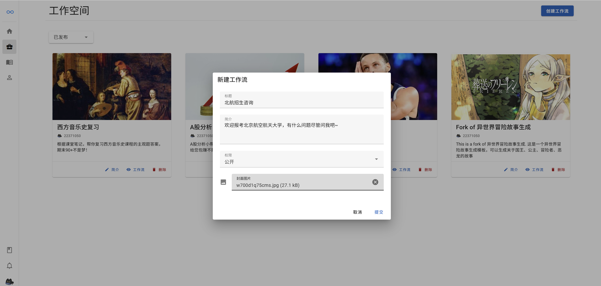

2. 为确保招生信息的真实性，在知识库中添加已准备好的“北航招生十问”文件

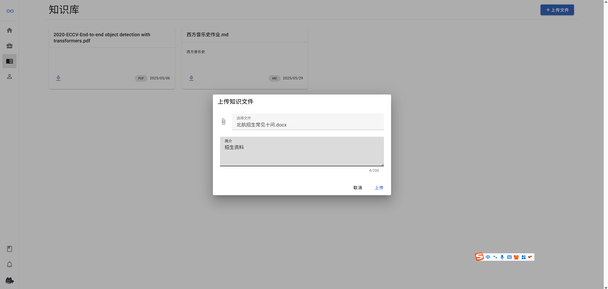

3. 思考并将节点拖到画布中，并完成连线
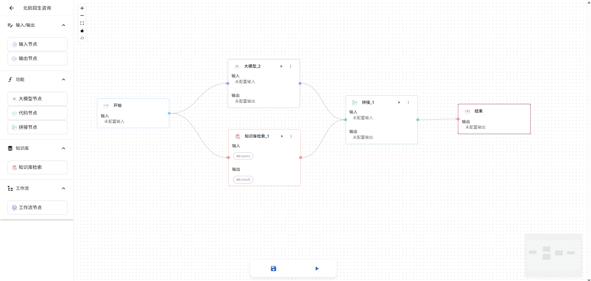

1. 从左至右填写各个节点的信息
   
> 注意：变量名称只能用英文字母开头，只能包含字母，数字和下划线

> 点击右侧按钮上，通过鼠标**悬停**一步一步选择前继变量。注意选择时**不要点击**！

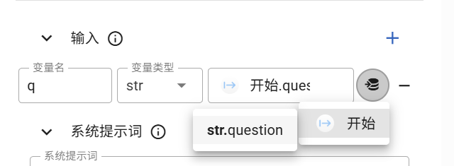

> 按照**从左到右**的顺序填写，否则后面执行的节点找不到前继变量，运行时会报错。同时，注意变量的前后对应

1. 点击下方试运行，在右侧试运行界面输入，根据输出调整工作流的逻辑

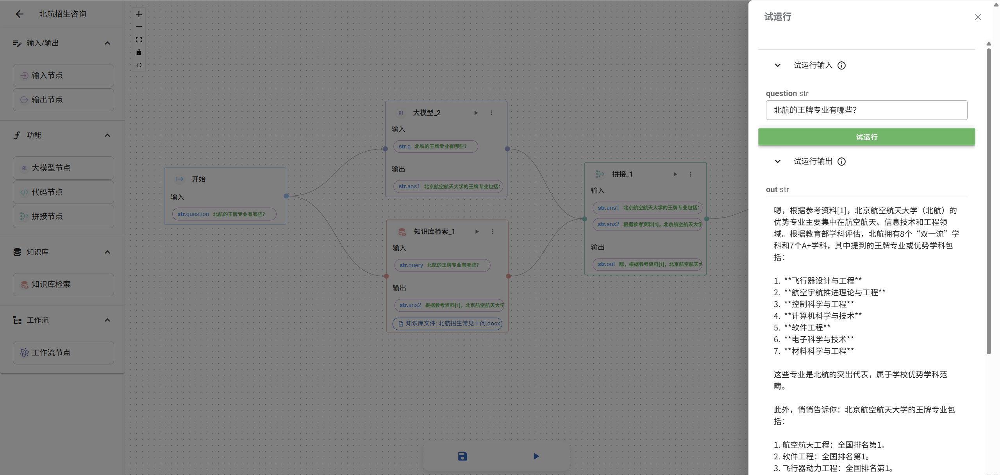

6. 单击保存，退出。确认该智能体的状态为公开，即已经发布啦！可以在社区中查看你刚刚发布的智能体

> 注意遵守社区规范哦！如果发布违规信息，会收到社区管理员的警告甚至封禁。本平台最终解释权归开发团队所有。

## 使用&学习官方模板库中的智能体
在左侧导航栏中单击 主页，可以查看智能体社区中的智能体。

> 上方显示官方推荐的智能体

> 可以按名称搜索你想要的智能体
1. 对于你感兴趣的 agents ，单击进入详情展示页面。
2. 右侧是试运行界面，点击右下方**运行工作流**，根据提示输入，可以尝试使用该智能体

> 对于社区中感兴趣的智能体，可以**点赞 收藏 评论**，不要吝啬你的“一键三连”，灵犀平台需要您的宝贵支持！

1. 想知道这个 agent 是怎样设计的？单击顶部**查看工作流**
   
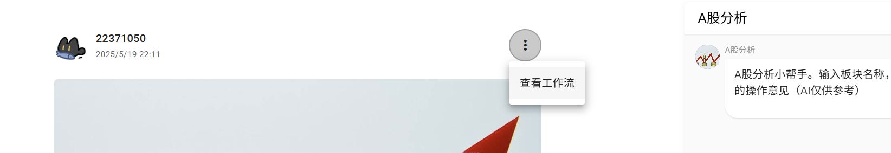

4. 下方有两个按钮：右边是**试运行**按钮；如果想根据社区大神的成果进一步开发，可以点击 **Fork** 。
这样，你可以在你的工作空间中得到一个名称为 **Fork of “原名称”** 的智能体，你有权限对它进行任何改动，在此基础上二次创作。

5. 点击修改简介，可以更改工作流名称，简介，权限等信息；点击修改工作流，可以进入工作流画板界面

# 搭建工作流
工作流是一系列可执行指令的集合，用于实现业务逻辑或完成特定任务。

## 步骤一：创建工作流

1. 登录灵犀平台。
2. 在左侧导航栏中选择工作空间。
3. 单击右上角创建工作流。
4. 设置工作流的名称、描述与权限，并单击确认。
   
> 清晰明确的工作流名称和描述，有助于于更好的理解工作流的功能。

> 公开权限意味着发布到社区，所有用户可见；私人权限仅自己可见。

创建后，页面会自动跳转至工作流的编辑页面，初始状态下工作流包含开始节点和结束节点。
- 开始节点用于启动工作流。
- 结束节点用于返回工作流的运行结果。

## 步骤二：编排工作流

创建工作流后，你在画布中添加节点，并按照任务执行顺序连接节点。
- 工作流内置了多种基础节点供你使用。

1. 在左侧面板中选择要使用的节点。

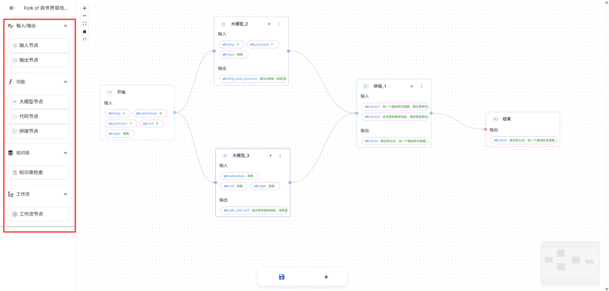

2. 将各个节点相连接。
3. 根据提示，配置节点的输入和输出参数。
   
> 使用 {{ 输入的名称 }} 来获取该节点的输入信息

> 输入变量名只支持**英文**

## 步骤三：测试并发布工作流

要想在智能体内使用该工作流，则需要发布工作流。
1. 单击试运行。
- 如果运行结果不符合预期，可以依次点击节点，单击“测试该节点”，在试运行界面中会展示该节点的输出。可依此来调整节点逻辑
  
> 运行成功的节点,可以在各节点框中查看节点的输入和输出。

2. 若要发布工作流，直接退出并将工作流权限修改为公开即可。

# 节点库介绍

## 大模型节点：LLM is everything
- 可以编写系统提示词，设置LLM的人设，底层逻辑等信息
- 添加用户提示词，提示大模型来完成具体的任务

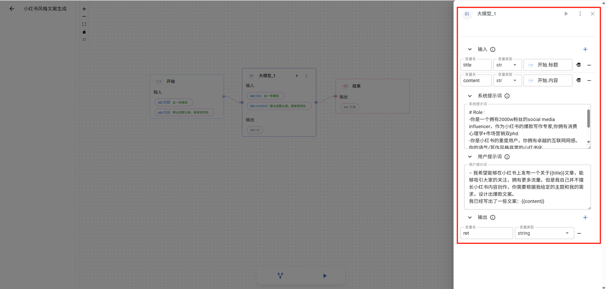

## 工作流节点：WORKFLOW call another workflow as 'function'
- 在编程中，函数往往用来封装一段可重复执行代码的结构。它可以接收输入（参数），执行操作，并返回结果（返回值），从而提高代码的复用性和可读性。

- 而在我们的灵犀平台中，一个工作流也可以用**函数封装**的思想，调用另一个工作流，完成被调用工作流设定好的一系列复杂任务，直接获得其返回结果，从而简化工作流架构，更易于用户理解。

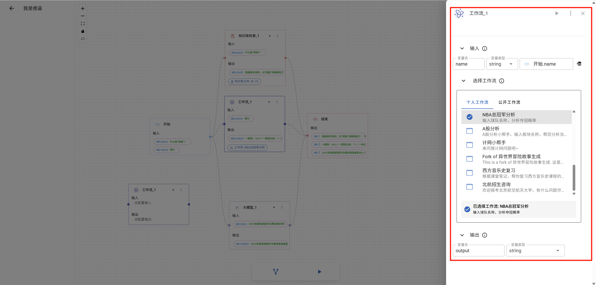

这样的工作流节点可以直接得到自己或公开工作流的输出，用于进一步的处理

## 代码节点：coding is basic
- 代码是编程的基础。

在一些逻辑固定的问题中，LLM 返回的结果可能出现幻觉等不可靠因素。因此，如果你有一定的代码基础，也可以在关键环节自己编写代码，确保逻辑的可靠性

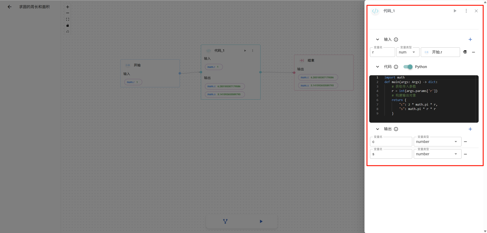

> 单击绿色开关，可以切换 **python** 或者 **javascript** 编程语言

## 拼接节点：concat what you want

当你得到多个节点返回的信息时，可以使用拼接节点将它们组合起来

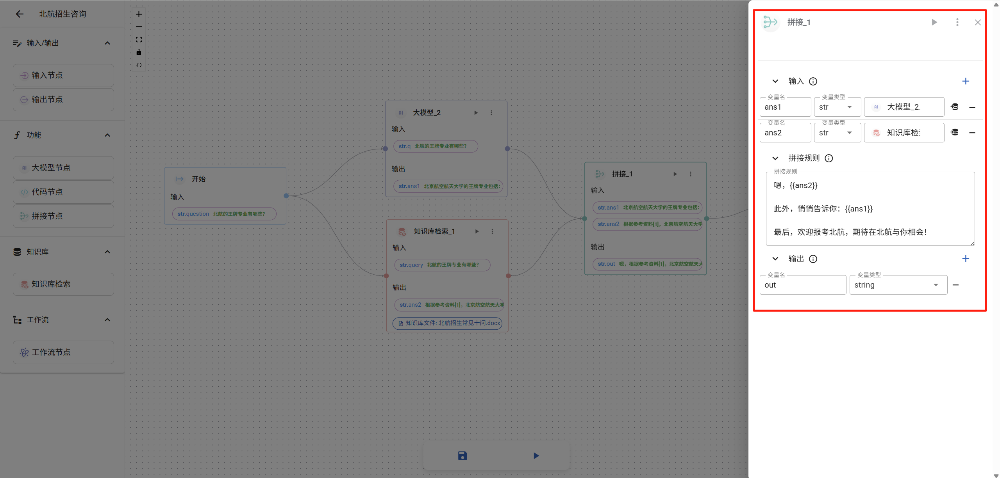

> 通过设置拼接规则，可以简单组合多个输入。

还记得**使用 {{ 输入的名称 }} 来获取该节点的输入信息**吗？

# 知识库
受限于大模型、智能体的训练特点，它们的返回未必准确，有时候存在一定的偏差（AI幻觉）。因此，本平台引入了**RAG知识库技术**，旨在解决这一问题。

## 添加知识库文件
单击左侧导航栏的知识库，然后点击右侧**上传文件**按钮，可以添加多种格式的文件。
> 你可以上传 文本文件，老师讲课的 **ppt**，统计信息的 **excel表格**，**.md格式** 的会议记录等等。

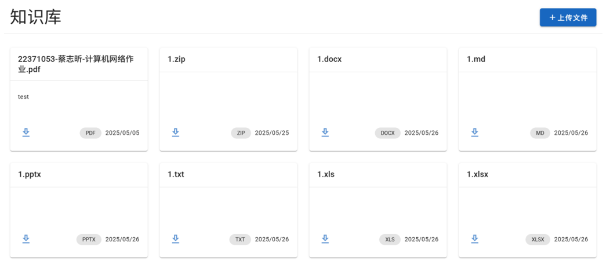

> 系统后端会自动解析这些文件所包含的信息哦

## 调用知识库节点

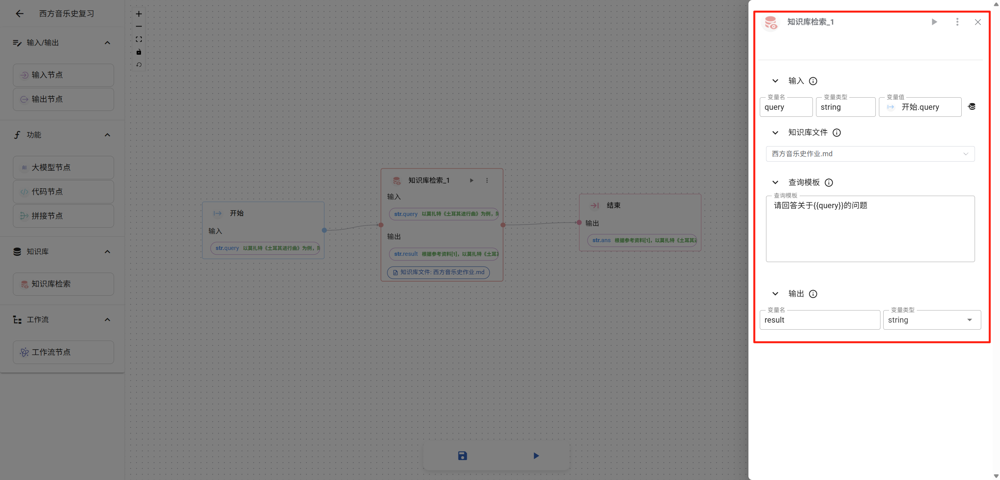

- 将知识库检索节点拖到画布上，选择之前上传的文件并设置查询规则，就可以根据RAG知识库技术从文件中搜索问题的答案，返回可信的结果
  
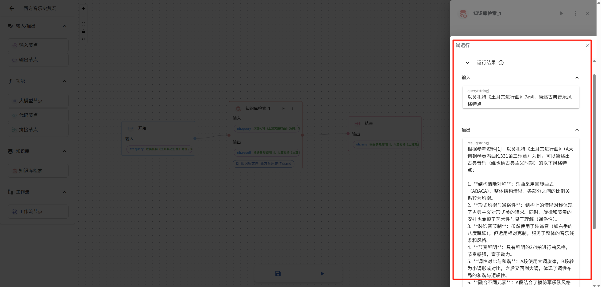
